  

  

  
  

---

### 👋 Hi, I'm Youssef

A **Flutter developer** who takes a real business need and turns it into a **production app** — clean, scalable and easy to maintain.

- 🚀 **Shipped to production** — event-booking apps on Google Play, a POS system and a government inquiry system.
- 🧩 **Business → software** — I understand the workflow first, then design the app around it.
- 🧠 **Clean code** — Clean Architecture, MVVM, SOLID, and state management with BLoC & Cubit.
- 💾 **More than APIs** — RESTful APIs *and* local databases (Hive, SQLite) for offline-first apps.
- ⚙️ **Ship it right** — CI/CD, flavors, and crash reporting / error monitoring in production.
- 🧑‍🏫 **Flutter instructor @ NTI** — taught **150+ students** across **4+ governorates**, with top-rated feedback.

---

### 🚀 In production

| App | What I did | |
|---|---|---|
| **Ratbli** — event planning (KSA) | Worked on the main consumer app |  |
| **Ratbli B2B** — events for companies | Built the **B2B version from the same codebase** using **flavors**, each flavor with its own API & config |  |
| **Kashier POS** | Fixed critical issues: invoice printing, pricing logic, client customizations | <a href="https://alkashier.com/">alkashier.com</a> |
| **Gov. inquiry system** — Ministry of Electricity | Built the full **auth module** (Clean Architecture + GetX + localization) | — |
| **JobTasker** — offline task manager | MVVM + Cubit + Hive, notifications, dark/light mode |  |

---

### 🌟 Projects

| Project | About | Stack |
|---|---|---|
| 🍓 [FruitHub](https://github.com/youssef-hossam/fruit_hup_app) | Shopping app + admin dashboard, social login, multi-language | Clean Arch · Cubit · Firebase |
| 💳 [Checkout](https://github.com/youssef-hossam/checkOut_app) | Stripe payments, saved cards, discounts | Stripe · Repository Pattern |
| ♻️ [Origami](https://github.com/salahsaads/Origami_app-main) | Exchange old items for points, then spend them in-app | Firebase · MVVM |
| 🧩 [AR Kids Coding](https://github.com/youssef-hossam/AR) | Teaches kids programming with 3D blocks in AR | ARCore · BLoC · GoRouter |
| 💬 [Chat App](https://github.com/youssef-hossam/ChatApp) | Real-time messaging | Firestore · Firebase Auth |
| 🍔 Loqma | Food delivery with a real backend & token refresh | Clean Arch · BLoC · Dio |

---

### 🧰 Tech stack

  

<table align="center">
  <tr><td><b>🧠 Architecture</b></td><td>Clean Code · Clean Architecture · MVVM · SOLID · Design Patterns</td></tr>
  <tr><td><b>🔄 State management</b></td><td>BLoC · Cubit · GetX</td></tr>
  <tr><td><b>🌐 Networking</b></td><td>RESTful APIs · Dio · Retrofit · Interceptors (access / refresh tokens)</td></tr>
  <tr><td><b>💾 Local databases</b></td><td>Hive · SQLite (sqflite) · Shared Preferences · offline-first apps</td></tr>
  <tr><td><b>🔥 Services</b></td><td>Firebase · Stripe · Google Maps · ARCore</td></tr>
  <tr><td><b>🚢 Ship & monitor</b></td><td>CI/CD (Codemagic) · Flavors (B2B / B2C) · Localization · APK/AAB releases · Crash reporting & error monitoring (Sentry, Firebase Crashlytics)</td></tr>
</table>

---

  

  <b>متنساش تعمل لايك وشير وسبسكرايب 😄</b>

